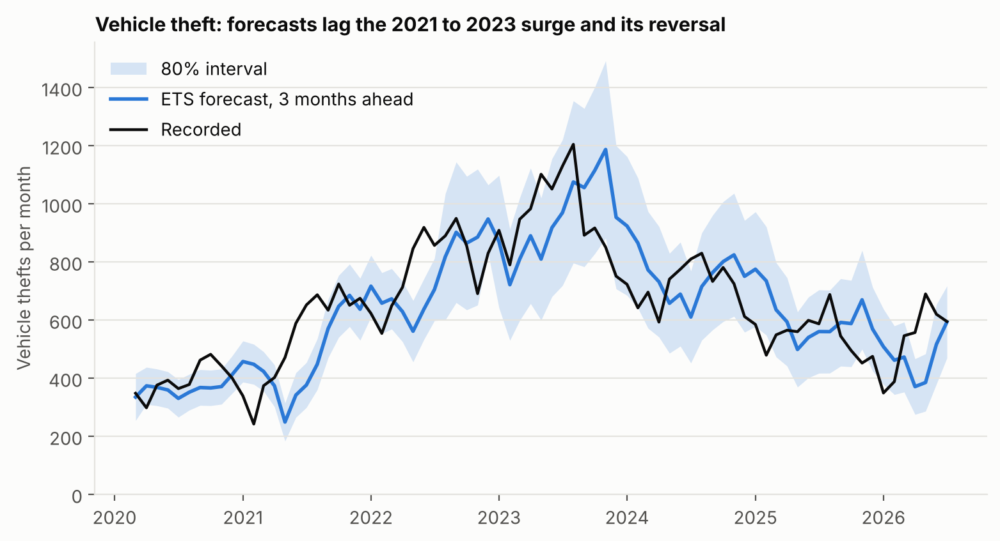
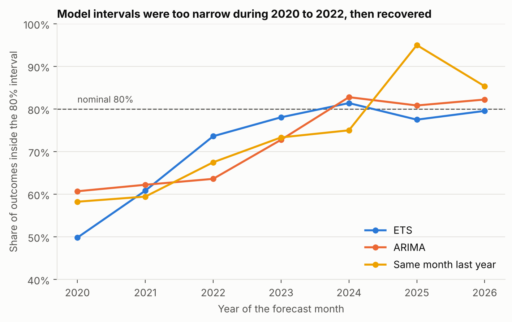

# When can monthly crime forecasts be trusted?

A forecasting study of recorded property and violent incidents in Montréal, 2015 to 2026.

**Author:** Dora Zhuang

Most forecasting write-ups report one accuracy number from one test period. This project tests
forecasts at 77 different starting points over six years, across five crime categories and 29
police districts, and asks where statistical models add value over "same month last year" and
how far their uncertainty ranges can be trusted.

**[Interactive summary](https://doraaadorable.github.io/montreal-crime-forecast/)** ·
**[All six findings, with tables](docs/FINDINGS.md)**

## Three findings

**1. A structural break defeats every method.**
Vehicle thefts rose from about 4,400 a year to 11,500 in 2023, then fell back. No model
anticipated either turn. On 2021 forecast months, ETS errors were 2.6 times the benchmark
scale, and only 40% of outcomes fell inside its 80% interval.



**2. Prediction intervals fail exactly when they matter.**
In 2020 and 2021, nominal 80% intervals covered 50% and 61% of outcomes. From 2023 onward they
covered 78% to 81%. Standard conformal recalibration then overcorrects to 91%, because its
calibration history still holds the shock; an adaptive version stays near 81%.



**3. For small districts, simple pooling beats separate models.**
A typical district-level series has 14 incidents a month. Splitting the citywide forecast by
each district's share of the last year is more accurate than fitting a model per district, and
a single model trained on all 145 district series is only 1% better than that split.

| District-level accuracy (MASE, lower is better) | All horizons | 1 month | 6 months |
|---|---|---|---|
| One model for all series (Poisson boosting) | **0.80** | **0.71** | **0.85** |
| Split the city forecast by last-year shares | 0.81 | 0.76 | 0.85 |
| Separate ETS model per series | 0.85 | 0.76 | 0.91 |
| Same month last year | 1.05 | 1.05 | 1.05 |

Citywide, models cut the benchmark's error by about 19%, mostly at short horizons: one month
ahead MASE is 0.75 against 1.25, and by six months the gap has nearly closed.

## Method in brief

- **Data.** 365,404 incidents recorded by the Service de police de la Ville de Montréal (SPVM),
  January 2015 to October 2026.
- **Backtest.** At each of 77 origins every model is refit on the data available then, and
  forecasts 1 to 6 months ahead with 80% and 95% intervals.
- **Models.** ETS, ARIMA and Theta; a pooled LightGBM model with a Poisson loss; two naive
  benchmarks.
- **Uncertainty.** Empirical coverage and interval scores; split and adaptive conformal
  calibration; Poisson and negative binomial intervals for small counts.
- **Hierarchy.** City, category, district and category by district (180 series), reconciled
  with bottom-up, top-down, OLS and WLS projections written out in `src/hierarchy.py`.

No hyperparameters were tuned on the backtest, and every calibration step uses only outcomes
known at the forecast origin.

## Limitations

- The counts are incidents **recorded** by police. They reflect reporting and recording
  practice as well as underlying crime, and they are not a measure of neighbourhood risk.
- The SPVM states this dataset is not its official statistics, and recent months can be revised.
- Three of the five district mergers were inferred from the data and should be confirmed.
- This is an accuracy study, not a tool for deploying police resources.

The full list is in [docs/FINDINGS.md](docs/FINDINGS.md#limitations).

## Reproduce

```bash
pip install -r requirements.txt
python src/download_data.py   # about 365,000 rows from the open data API
python src/backtest.py        # about 2 minutes on 4 cores
python src/calibrate.py
python src/hierarchy.py       # about 6 minutes on 4 cores
python src/count_models.py    # about 1 minute
python src/figures.py
python src/build_page.py      # rebuilds docs/index.html
```

Results depend on the download date, because the source is updated daily.

## Data source

[Actes criminels](https://donnees.montreal.ca/dataset/actes-criminels), Service de police de la
Ville de Montréal, via the Ville de Montréal open data portal. Licensed under
[CC BY 4.0](https://creativecommons.org/licenses/by/4.0/).
