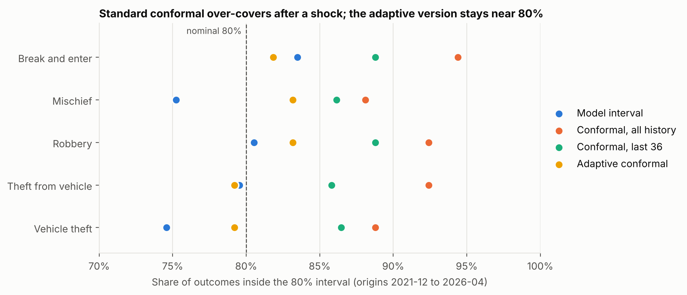

# Full findings: when can monthly crime forecasts be trusted?

A forecasting study of recorded property and violent incidents in Montréal, 2015 to 2026.

**Author:** Dora Zhuang

Most forecasting write-ups report one accuracy number from one test period. This project asks a
harder question: across 77 forecast origins and five crime categories, **where do statistical
models add value over "same month last year", and how far can their uncertainty ranges be
trusted?**

## Findings

**1. Models beat the benchmark, but mostly at short horizons.**
Averaged over all categories, horizons and origins, ETS has a MASE of 1.01 against 1.25 for the
seasonal naive benchmark, an error about 19% lower. One month ahead the gap is large (0.75
against 1.25). Six months ahead it has nearly closed (1.13 against 1.23).

**2. A structural break defeats every method.**
Vehicle thefts rose from about 4,400 a year (2015 to 2020) to 11,500 in 2023, then fell back.
No model anticipated either turn. ETS had a MASE of 2.63 on 2021 forecast months, and only 40%
of outcomes fell inside its 80% interval.

**3. Prediction intervals fail exactly when they matter.**
During 2020 and 2021, nominal 80% intervals from ETS covered 50% and 61% of outcomes. From 2023
onward they covered 78% to 81%. Interval quality depends on the period, so a single coverage
number hides the problem.

**4. Standard conformal calibration overcorrects after a shock.**
Recalibrating intervals with past forecast errors pushed 80% coverage up to 91%, because the
calibration history still contained the 2020 and 2021 errors. Adaptive conformal inference stayed
near the target (81%), at the cost of wider intervals than the model's own in calm periods.

**5. At district level, splitting the city forecast beats forecasting each district.**
Extending the study to 29 police districts gives 180 series in four levels. The smallest series
(one category in one district) have a median of 14 incidents a month. Forecast independently,
the series do not add up: the sum of the district forecasts differs from the city forecast by
6% on average. Among five ways of making them consistent, the simplest one, splitting the city
total by each district's share of the last 12 months, is the most accurate at district level.

| Method | Total | Category | District | Category x district |
|---|---|---|---|---|
| Top-down (last-year shares) | 0.84 | 0.97 | **0.80** | **0.81** |
| WLS reconciliation | 0.88 | **0.92** | 0.81 | 0.85 |
| Independent ETS (does not add up) | 0.84 | 1.00 | 0.84 | 0.85 |
| Bottom-up | 0.94 | 0.98 | 0.83 | 0.85 |
| OLS reconciliation | 0.84 | 0.98 | 0.82 | 0.87 |
| Same month last year | 1.19 | 1.26 | 1.03 | 1.05 |

MASE pooled within each level, same 77 origins and horizons as above. No single method wins at
every level: bottom-up is clearly worst for the city total, and WLS is best for categories.

**6. For small counts, the distribution matters more than the model.**
At the finest level (one category in one district), a single gradient-boosting model with a
Poisson loss, trained on all 145 series at once, has the lowest error, but its lead over the
top-down split (1% overall, winning at 68% of origins) is too small to tell from chance. Its edge is at
1 to 2 months ahead; from 3 months on the two are level. For the 20 sparsest series (under 5
incidents a month), per-series ETS is still best.

| Method (category x district) | All | 1 month | 6 months | Under 5 a month |
|---|---|---|---|---|
| Global Poisson boosting | **0.80** | **0.71** | **0.85** | 0.79 |
| Top-down (last-year shares) | 0.81 | 0.76 | 0.85 | 0.78 |
| Independent ETS | 0.85 | 0.76 | 0.91 | **0.77** |
| Same month last year | 1.05 | 1.05 | 1.05 | 0.99 |

The choice of predictive distribution has a larger effect than the choice of model. A Poisson
interval assumes variance equals the mean and covers only 66% of outcomes at a nominal 80%.
Allowing extra variance with a negative binomial gives the best interval score, though it
over-covers at 87%.

| 80% interval (category x district) | Coverage | Mean width | Interval score |
|---|---|---|---|
| Global boosting + negative binomial | 87.2% | 18.7 | **3.73** |
| Top-down + negative binomial | 86.4% | 18.7 | **3.73** |
| ETS normal interval | 77.4% | 17.2 | 3.96 |
| Global boosting + Poisson | 66.4% | 9.8 | 4.29 |
| Top-down + Poisson | 65.1% | 9.8 | 4.33 |

**7. Which differences are real.**
Error ratios with 95% intervals from a moving-block bootstrap over the 77 origins (blocks of
12, because errors at neighbouring origins overlap). An interval that includes 1 means the data
cannot separate the two methods.

| Comparison (first vs second) | Error ratio | 95% interval | Reading |
|---|---|---|---|
| Citywide: ETS vs same month last year | 0.81 | 0.71 to 0.86 | ETS better |
| 1 month ahead | 0.60 | 0.51 to 0.66 | ETS better |
| 6 months ahead | 0.92 | 0.81 to 0.99 | ETS better |
| Break and enter | 0.97 | 0.83 to 1.10 | not distinguishable |
| Mischief | 0.82 | 0.70 to 0.92 | ETS better |
| Robbery | 0.90 | 0.76 to 1.08 | not distinguishable |
| Theft from vehicle | 0.81 | 0.70 to 0.85 | ETS better |
| Vehicle theft | 0.70 | 0.53 to 0.86 | ETS better |
| Citywide: ARIMA vs ETS | 1.00 | 0.95 to 1.09 | not distinguishable |
| Citywide: ensemble vs ETS | 0.97 | 0.95 to 1.00 | not distinguishable |
| District: global model vs top-down | 0.99 | 0.98 to 1.00 | not distinguishable |
| District: global model vs separate ETS | 0.94 | 0.92 to 0.96 | global better |
| District: top-down vs separate ETS | 0.95 | 0.93 to 0.97 | top-down better |

The ensemble is the plain average of the ETS, ARIMA and Theta forecasts. It has the lowest
citywide MASE (0.98 against 1.01 for ETS) and beats ETS at 71% of origins, but the interval
just reaches 1. Vehicle theft shows that a method can be far better than the benchmark (ratio
0.70) and still be a poor forecast in absolute terms (MASE 1.46).

## Results in numbers

Rolling-origin backtest, origins December 2019 to April 2026, horizons 1 to 6 months.
MASE below 1 means the forecast beats the in-sample seasonal naive error.

| Category | ETS | ARIMA | Theta | Same month last year | Last month |
|---|---|---|---|---|---|
| Break and enter | 0.85 | 0.87 | 0.90 | 0.88 | 1.06 |
| Mischief | 0.93 | 1.04 | 0.99 | 1.13 | 1.55 |
| Robbery | 0.91 | 0.79 | 1.00 | 1.02 | 0.96 |
| Theft from vehicle | 0.91 | 0.95 | 0.92 | 1.12 | 1.34 |
| Vehicle theft | 1.46 | 1.42 | 1.40 | 2.09 | 1.45 |
| **All** | **1.01** | **1.02** | **1.04** | **1.25** | **1.27** |

80% interval calibration for ETS, origins December 2021 to April 2026 (the first two years are
needed to build a calibration set). The interval score rewards narrow intervals and penalizes
misses; lower is better.

| Method | Coverage (target 80%) | Interval score |
|---|---|---|
| Model interval | 78.7% | 3.77 |
| Conformal, all history | 91.2% | 4.46 |
| Conformal, last 36 errors | 87.2% | 4.35 |
| Adaptive conformal | 81.3% | 4.33 |

## Method

- **Data.** 365,404 incidents recorded by the Service de police de la Ville de Montréal (SPVM),
  January 2015 to October 2026, aggregated to citywide monthly counts for five categories.
- **Backtest.** At each of 77 origins every model is refit on the data available at that origin,
  then forecasts 1 to 6 months ahead with 80% and 95% intervals. This gives 2,310 forecasts per
  model.
- **Models.** ETS, ARIMA and Theta with automatic order selection, against two naive benchmarks.
- **Metrics.** MASE for point accuracy; empirical coverage and the interval (Winkler) score for
  uncertainty.
- **Hierarchy.** 5 categories by 29 districts (145 bottom series), plus district, category and
  city totals. Reconciliation is implemented from the projection formula in `src/hierarchy.py`:
  bottom-up, top-down, and OLS and structurally weighted (WLS) projections.
- **Count models.** A LightGBM model with a Poisson objective, one per horizon and origin,
  trained across all 145 district series on lags, rolling means, the seasonal lag and category
  momentum. Hyperparameters were fixed in advance and not tuned. Negative binomial dispersion
  is estimated at each origin from forecasts whose outcomes were already known.
- **Calibration.** Split conformal on relative errors with an expanding and a 36-forecast
  window, and adaptive conformal inference (Gibbs and Candès, 2021) with a step size fixed in
  advance at 0.05. Every calibration set uses only outcomes observed before the forecast origin.

## Limitations

- The counts are incidents **recorded** by police. They reflect reporting and recording
  practice as well as underlying crime, and they are not a measure of neighbourhood risk.
- The SPVM states this dataset is not its official statistics. Incident types can be revised
  after the initial report, so the most recent months may still change.
- When one event involves several offences, only the most serious is published.
- Five districts were merged into neighbours during the period (24 into 26 in 2019, 11 into 9
  in 2020, 33 into 31 in 2021, 22 into 21 and 55 into 5 later). Their history is mapped to
  today's boundaries, so district results describe current districts.
- District intervals were evaluated at the finest level only, with one dispersion value
  shared by all series. Count intervals are whole numbers, which pushes coverage above target.
- The bootstrap intervals treat the 77 origins as the sample. They do not cover the choice of
  test period itself; a different decade could rank methods differently.
- "Offences causing death" (two or three a month) is excluded as too sparse for these models.
- The adaptive conformal results start in December 2021, so that method was not tested through
  the 2020 shock itself.
- Forecasts here are an accuracy study, not a tool for deploying police resources.

## Next steps

- Coherent prediction intervals across the whole district hierarchy.
- Series-specific dispersion, and methods that adapt faster to level shifts.
- An explicit treatment of late revisions in recent months.

## Data source

[Actes criminels](https://donnees.montreal.ca/dataset/actes-criminels), Service de police de la
Ville de Montréal, via the Ville de Montréal open data portal. Licensed under
[CC BY 4.0](https://creativecommons.org/licenses/by/4.0/).

## Reference

Gibbs, I., and Candès, E. (2021). Adaptive conformal inference under distribution shift.
*Advances in Neural Information Processing Systems*, 34.
