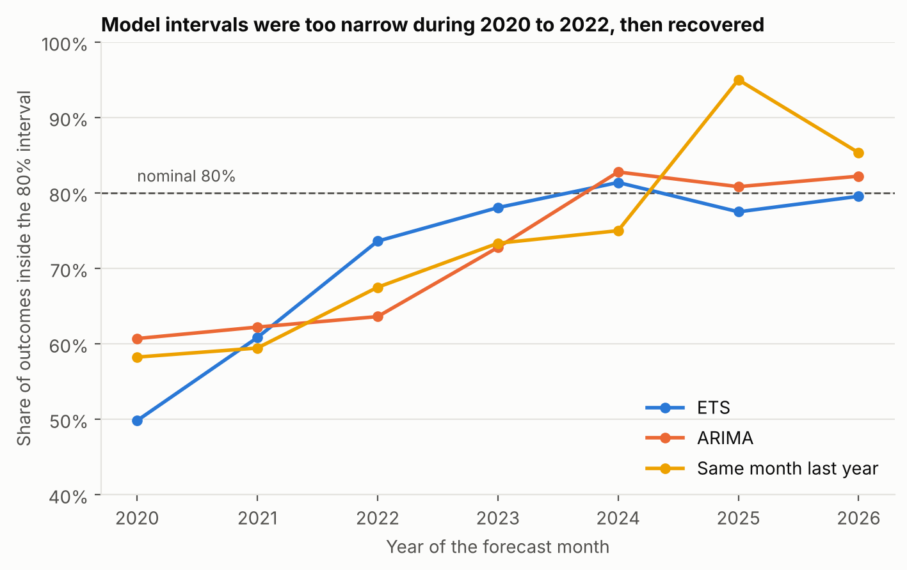

# Full findings

**When can monthly crime forecasts be trusted?** Dora Zhuang

Recorded property and violent incidents in Montréal, 2015 to 2026. Every model is refit at 77
points in time and forecasts 1 to 6 months ahead, using only the months before that point.

## Findings

**1. Models beat the benchmark, but mostly at short horizons.**
Averaged over all categories, horizons and origins, ETS has a MASE of 1.01 against 1.25 for the
seasonal naive benchmark, an error about 19% lower. One month ahead the gap is large (0.75
against 1.25). Six months ahead it has nearly closed (1.13 against 1.23).

**2. A structural break defeats every method tested.**
Vehicle thefts rose from about 4,400 a year (2015 to 2020) to 11,500 in 2023, then fell back.
None of the methods tested anticipated either turn. ETS had a MASE of 2.63 on 2021 forecast months, and only 40%
of outcomes fell inside its 80% interval.

A model with a shorter memory should adapt faster. It did not. Refitting ETS on only the last
24, 36 or 60 months made no clear difference on vehicle theft during the surge, and cost 25%
to 45% in accuracy on the other categories.

| Error ratio vs full history (95% interval) | Last 24 months | Last 36 months | Last 60 months |
|---|---|---|---|
| Vehicle theft, 2021 to 2023 | 0.98 (0.95 to 1.05) | 0.98 (0.95 to 1.02) | 1.01 (0.99 to 1.02) |
| Vehicle theft, other years | 1.03 (1.00 to 1.10) | 1.02 (1.00 to 1.03) | 0.99 (0.91 to 1.12) |
| Other four categories, 2021 to 2023 | 1.45 (1.34 to 1.54) | 1.42 (1.29 to 1.52) | 1.15 (1.06 to 1.34) |
| Other four categories, other years | 1.25 (1.10 to 1.37) | 1.33 (1.23 to 1.44) | 1.04 (0.99 to 1.13) |

ETS already weights recent months more heavily, so discarding old data adds little
responsiveness and removes the history needed to estimate seasonality. The surge was not
visible in the series' own past, whatever the length of memory.

**3. Prediction intervals fail exactly when they matter.**
During 2020 and 2021, nominal 80% intervals from ETS covered 50% and 61% of outcomes. From 2023
onward they covered 78% to 81%. A single coverage number averaged over the whole period would
hide this.

**4. The conformal settings tested did not improve on the model's own intervals.**
Recalibrating with past forecast errors pushed 80% coverage up to 91%, because the calibration
history still contained the 2020 and 2021 errors. Adaptive conformal inference averaged 81%,
but by overshooting and then undershooting, and the ETS interval scored better in every year.

| Forecast year | ETS coverage | Adaptive coverage | ETS score | Adaptive score |
|---|---|---|---|---|
| 2022 | 76% | 92% | 4.15 | 4.76 |
| 2023 | 78% | 89% | 4.15 | 4.88 |
| 2024 | 81% | 80% | 3.62 | 4.14 |
| 2025 | 78% | 74% | 3.52 | 4.00 |
| 2026 | 80% | 73% | 3.48 | 3.90 |

The adaptive method needs two years of forecasts before it starts, so this test begins after
the 2020 shock, where the ETS intervals were at their worst.

**5. At district level, splitting the city forecast beats forecasting each district.**
Extending the study to 29 police districts gives 180 series in four levels. The smallest series
(one category in one district) have a median of 14 incidents a month. Forecast independently,
the series do not add up: the sum of the district forecasts differs from the city forecast by
6% on average. Among five ways of making them consistent, the simplest one, splitting the city
total by each district's share of the last 12 months, is the most accurate at district level.

| Method | Total | Category | District | Category x district |
|---|---|---|---|---|
| Top-down (last-year shares) | 0.84 | 0.97 | **0.80** | **0.81** |
| WLS reconciliation | 0.88 | **0.92** | 0.81 | 0.85 |
| Independent ETS (does not add up) | 0.84 | 1.00 | 0.84 | 0.85 |
| Bottom-up | 0.94 | 0.98 | 0.83 | 0.85 |
| OLS reconciliation | 0.84 | 0.97 | 0.82 | 0.87 |
| Same month last year | 1.19 | 1.26 | 1.03 | 1.05 |

MASE pooled within each level. No method wins at every level: bottom-up is worst for the city
total, and WLS is best for categories. OLS and WLS produce some negative forecasts (1,055 and
663 of 83,160). These are set to zero at the bottom level and the upper levels re-summed, so
every reconciled forecast is non-negative and adds up exactly.

**6. For small counts, the distribution matters more than the model.**
At the finest level (one category in one district), a single gradient-boosting model with a
Poisson loss, trained on all 145 series at once, has the lowest error, but its lead over the
top-down split (1% overall, winning at 68% of origins) is not clearly different from zero. Its edge is at
1 to 2 months ahead; from 3 months on the two are level.

| Method (category x district) | All | 1 month | 6 months |
|---|---|---|---|
| Global Poisson boosting | **0.80** | **0.71** | **0.85** |
| Top-down (last-year shares) | 0.81 | 0.76 | 0.85 |
| Independent ETS | 0.85 | 0.76 | 0.91 |
| Same month last year | 1.05 | 1.05 | 1.05 |

Is the gain from pooling or from the model? The comparison with ETS changes both at once, so a
second test changes only one: the same LightGBM settings and inputs, trained once on all 145
series or separately on each.

| Inputs | Pooled | Separate | Error ratio | 95% interval |
|---|---|---|---|---|
| Recent levels only (last month, 3- and 12-month means) | 0.831 | 0.891 | 0.93 | 0.91 to 0.95 |
| All inputs except series identity | 0.806 | 0.870 | 0.93 | 0.90 to 0.95 |

Pooling cuts error by 7% and wins at 90% of origins. Trained separately, this model is worse
than ETS (0.85), so the model class alone does not explain the result. A tree model fitted to
about 100 rows is short of data, which is the situation pooling addresses.

Features matter less. Removing any one group barely moves the error, though one input can
stand in for another, and stripping the model to three inputs costs 4%.

| Global model variant | All | 1 month | 6 months |
|---|---|---|---|
| Full model | 0.799 | 0.708 | 0.846 |
| Without seasonal lag | 0.799 | 0.709 | 0.847 |
| Without category momentum | 0.802 | 0.709 | 0.854 |
| Without series identity (category, district) | 0.806 | 0.714 | 0.854 |
| Recent levels only (last month, 3- and 12-month means) | 0.831 | 0.739 | 0.883 |

The choice of predictive distribution has a larger effect than the choice of model. A Poisson
interval assumes variance equals the mean and covers only 66% of outcomes at a nominal 80%.
The shortfall grows with volume: Poisson is adequate for series under 5 incidents a month and
fails for busy ones. A negative binomial fixes this but over-covers; estimating its dispersion
per category brings coverage closer to target and gives the best score.

| 80% coverage, same point forecast | Under 5 a month | 5 to 20 | Over 20 |
|---|---|---|---|
| Poisson | 82% | 66% | 60% |
| Negative binomial, one dispersion | 89% | 86% | 88% |
| Negative binomial, dispersion by category | 87% | 84% | 87% |

Volume bands are set from the first five years, before any forecast is scored.

| 80% interval (category x district) | Coverage | Mean width | Interval score |
|---|---|---|---|
| Global boosting + negative binomial by category | 85.7% | 18.3 | **3.71** |
| Global boosting + negative binomial | 87.2% | 18.7 | 3.73 |
| Top-down + negative binomial | 86.4% | 18.7 | 3.73 |
| ETS normal interval | 77.4% | 17.2 | 3.96 |
| Global boosting + Poisson | 66.4% | 9.8 | 4.29 |
| Top-down + Poisson | 65.1% | 9.8 | 4.33 |

**7. Which differences are real.**
Error ratios with 95% intervals from a moving-block bootstrap over the 77 origins, in blocks of
12 because errors at neighbouring origins overlap. An interval that includes 1 means no clear
difference was detected.

| Comparison (first vs second) | Error ratio | 95% interval | Reading |
|---|---|---|---|
| Citywide: ETS vs same month last year | 0.81 | 0.71 to 0.86 | ETS better |
| 1 month ahead | 0.60 | 0.51 to 0.66 | ETS better |
| 6 months ahead | 0.92 | 0.81 to 0.99 | ETS better |
| Break and enter | 0.97 | 0.83 to 1.10 | no clear difference |
| Mischief | 0.82 | 0.70 to 0.92 | ETS better |
| Robbery | 0.90 | 0.76 to 1.08 | no clear difference |
| Theft from vehicle | 0.81 | 0.70 to 0.85 | ETS better |
| Vehicle theft | 0.70 | 0.53 to 0.86 | ETS better |
| Citywide: ARIMA vs ETS | 1.00 | 0.95 to 1.09 | no clear difference |
| Citywide: ensemble vs ETS | 0.97 | 0.95 to 1.00 | no clear difference |
| District: global model vs top-down | 0.99 | 0.98 to 1.00 | no clear difference |
| District: global model vs separate ETS | 0.94 | 0.92 to 0.96 | global better |
| District: top-down vs separate ETS | 0.95 | 0.93 to 0.97 | top-down better |

Every comparison above was rerun with blocks of 6 and 18 origins, on origins before and after
January 2023, and without scoring the newest three target months
([table](../results/significance_robustness.csv)). Ten of the thirteen keep the same reading.
Three change with the check:

- **Six months ahead.** With blocks of 6 the interval is 0.77 to 1.05, and for origins from
  2023 the ratio is 0.97 (0.88 to 1.05).
- **Ensemble vs ETS.** Clear for origins from 2023 (0.95, 0.94 to 0.96) and with blocks of 6,
  not otherwise.
- **Global model vs top-down.** The upper bound sits at 1.00 in every check.

"No clear difference" means the test could not separate the two methods. It does not show they
are equivalent.

The ensemble is the plain average of the ETS, ARIMA and Theta forecasts. It has the lowest
citywide MASE (0.98 against 1.01 for ETS) and beats ETS at 71% of origins, but the interval
just reaches 1. On vehicle theft, ETS is far better than the benchmark (ratio 0.70) and still
a poor forecast in absolute terms (MASE 1.46).

**8. What this means for planning.**
An illustration with assumed costs. Suppose workload scales with recorded incidents and
running short costs nine times as much as holding spare capacity. The plan that fits those
costs is the 90th percentile of the forecast, which should fall short 10% of the time.

| Plan | Cases short | Spare capacity | Cost |
|---|---|---|---|
| ETS 90th percentile | 17.5% | 19% | **0.262** |
| ETS forecast + 20% | 17.8% | 20% | 0.280 |
| ETS forecast + 10% | 32.5% | 12% | 0.358 |
| Last year's count + 20% | 23.1% | 22% | 0.368 |
| Last year's count + 10% | 34.5% | 15% | 0.468 |
| ETS forecast, no margin | 52.7% | 6% | 0.562 |

A case is one category, forecast origin and horizon, so each calendar month is counted several
times. Spare capacity is the amount planned above what happened, as a share of actual
incidents. Cost weights shortfall 9 to 1 against spare capacity, on the MASE scale.

Forecast-based plans cost 29% less than plans based on last year's count. The model's own
interval beats a flat 20% margin on the same forecast by 6%, so most of the value is in the
point forecast.

For a statement about calendar months, take one-month-ahead plans only, where each category
has one plan per month.

| 90th percentile plan, one month ahead | Months short | Share |
|---|---|---|
| Robbery | 8 of 77 | 10% |
| Mischief | 8 of 77 | 10% |
| Break and enter | 10 of 77 | 13% |
| Theft from vehicle | 14 of 77 | 18% |
| Vehicle theft | 16 of 77 | 21% |
| Average | | 14.5% |

By year the average was 20% in 2020, 25% in 2021, then 8% to 10% in 2023 to 2025.

**9. A monitor on forecast errors signalled early in the surge.**
A historical case, not a validated warning system. A CUSUM chart on one-month-ahead ETS errors,
with textbook settings (allowance 0.5, threshold 4 standard deviations) and using only
forecasts already scored, raised 13 alarms across the five categories in 77 months. Months are
those the incidents occurred in; a monitor would see each once that month's data was published.

| Category | Alarms | When |
|---|---|---|
| Vehicle theft | 4 | Feb 2021 (below), Apr 2021, Jul 2021, May 2022 (above) |
| Theft from vehicle | 3 | Feb 2020 (above), May 2020 (below), Jul 2021 (above) |
| Break and enter | 3 | May 2020, Feb 2021 (below), May 2022 (above) |
| Mischief | 2 | Apr 2020 (below), Dec 2023 (above) |
| Robbery | 1 | Jun 2025 (above) |

For vehicle theft the first upward alarm came in April 2021, at 402 thefts against a forecast
of 342, two months after a downward alarm at a February low. The second came in July 2021 at
652 thefts, against a 2020 average of 392. Counts peaked at 1,205 in August 2023. The same
threshold triggered both alarms, and nothing in the chart marks one as more meaningful than
the other.

No downward alarm followed the peak. Counts stayed below forecast for six months, then
rebounded in spring 2024, and the accumulated deviation never reached the threshold. Wider
stated uncertainty was not the reason: rescaling the errors to the 2020 level of uncertainty
still gives no downward alarm.

With no independent record of when real changes occurred, these results give an alarm count,
not a false-alarm rate or a detection delay.

## Results in numbers

Rolling-origin backtest, origins December 2019 to April 2026, horizons 1 to 6 months.
MASE below 1 means the forecast beats the in-sample seasonal naive error.

| Category | ETS | ARIMA | Theta | Same month last year | Last month |
|---|---|---|---|---|---|
| Break and enter | 0.85 | 0.87 | 0.90 | 0.88 | 1.06 |
| Mischief | 0.93 | 1.04 | 0.99 | 1.13 | 1.55 |
| Robbery | 0.91 | 0.79 | 1.00 | 1.02 | 0.96 |
| Theft from vehicle | 0.91 | 0.95 | 0.92 | 1.12 | 1.34 |
| Vehicle theft | 1.46 | 1.42 | 1.40 | 2.09 | 1.45 |
| **All** | **1.01** | **1.02** | **1.04** | **1.25** | **1.27** |

80% interval calibration for ETS, origins December 2021 to April 2026; the first two years
build the calibration set. The interval score rewards narrow intervals and penalizes misses.
Lower is better.

| Method | Coverage (target 80%) | Interval score |
|---|---|---|
| Model interval | 78.7% | 3.77 |
| Conformal, all history | 91.2% | 4.46 |
| Conformal, last 36 errors | 87.2% | 4.35 |
| Adaptive conformal | 81.3% | 4.33 |

## Method

- **Data.** 365,404 incidents recorded by the Service de police de la Ville de Montréal (SPVM),
  January 2015 to October 2026, aggregated to citywide monthly counts for five categories.
- **Backtest.** At each of 77 origins every model is refit on the months up to that origin,
  then forecasts 1 to 6 months ahead with 80% and 95% intervals. This gives 2,310 forecasts per
  model.
- **Models.** ETS, ARIMA and Theta with automatic order selection, against two naive benchmarks.
- **Metrics.** MASE for point accuracy; empirical coverage and the interval (Winkler) score for
  uncertainty.
- **Hierarchy.** 5 categories by 29 districts (145 bottom series), plus district, category and
  city totals. Reconciliation is implemented from the projection formula in `src/hierarchy.py`:
  bottom-up, top-down, and OLS and structurally weighted (WLS) projections.
- **Count models.** A LightGBM model with a Poisson objective, one per horizon and origin,
  trained across all 145 district series on lags, rolling means, the seasonal lag and category
  momentum. Hyperparameters were fixed in advance and not tuned. Negative binomial dispersion
  is estimated at each origin from forecasts whose outcomes were already known.
- **Calibration.** Split conformal on relative errors with an expanding and a 36-forecast
  window, and adaptive conformal inference (Gibbs and Candès, 2021) with a step size fixed in
  advance at 0.05. The original method returns an infinite interval when its target rate
  reaches zero; this implementation caps it at the largest past error. Every calibration set
  uses only outcomes observed before the forecast origin.

## Limitations

- The counts are incidents **recorded** by police. They reflect reporting and recording
  practice as well as crime itself.
- Past months come from the version of the data downloaded on 15 November 2026
  (`data/manifest.json`), not from what was published at each forecast origin. Incident types
  can be revised after the initial report. Not scoring the newest three months leaves the
  headline ratio at 0.81, so those months do not drive the result. That is not a test of
  revisions or of publication delay. A delay of k months turns an h-month forecast into an
  (h+k)-month one, so its cost can be read from the horizon results: MASE rises from 0.75 at
  one month to 0.90 at two. Revisions need dated snapshots; the first is in `data/snapshots`.
- Five districts merged into neighbours during the period (24 into 26, 11 into 9, 33 into 31,
  22 into 21, 55 into 5). Their history is mapped to today's boundaries.
- When the adaptive conformal rate falls to zero, the interval is capped at the largest past
  error instead of made infinite. This happened for 6% of 95% intervals and no 80% intervals.
- "Offences causing death" (two or three a month) is excluded as too sparse.

## Next steps

- Coherent prediction intervals across the whole district hierarchy.
- Methods that adapt faster to level shifts.
- A snapshot each month (`python src/snapshot.py`), to measure how much recent months are
  revised.
- A planning use case with unequal costs for under- and over-forecasting.

## Data source

[Actes criminels](https://donnees.montreal.ca/dataset/actes-criminels), Service de police de la
Ville de Montréal, Ville de Montréal open data portal,
[CC BY 4.0](https://creativecommons.org/licenses/by/4.0/).

## Reference

Gibbs, I., and Candès, E. (2021). Adaptive conformal inference under distribution shift.
*Advances in Neural Information Processing Systems*, 34.
