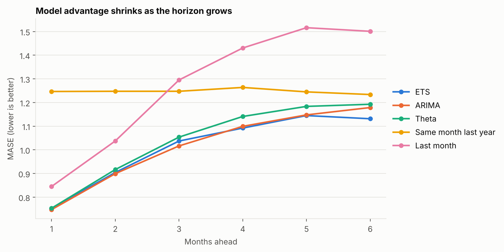
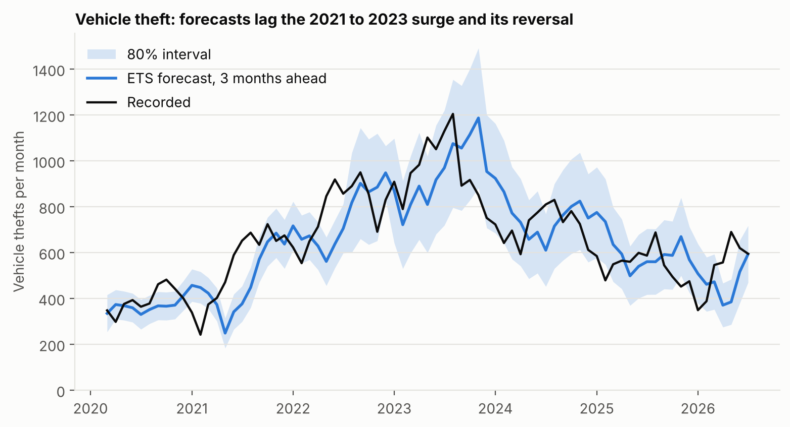

# Full findings

**When can monthly crime forecasts be trusted?** Dora Zhuang

Recorded property and violent incidents in Montréal, 2015 to 2026. Every model is refit at 77
points in time and forecasts 1 to 6 months ahead from the months before that point. Accuracy
is reported as MASE: forecast error divided by the error of "same month last year" in the
training data. Below 1 beats that benchmark.

## Accuracy

**1. Models beat the benchmark, mostly at short horizons.**
Across all categories and horizons, ETS has a MASE of 1.01 against 1.25 for the benchmark, 19%
lower. One month ahead the gap is wide (0.75 against 1.25). Six months ahead it has nearly
closed (1.13 against 1.23).

| Category | ETS | ARIMA | Theta | Same month last year | Last month |
|---|---|---|---|---|---|
| Break and enter | 0.85 | 0.87 | 0.90 | 0.88 | 1.06 |
| Mischief | 0.93 | 1.04 | 0.99 | 1.13 | 1.55 |
| Robbery | 0.91 | 0.79 | 1.00 | 1.02 | 0.96 |
| Theft from vehicle | 0.91 | 0.95 | 0.92 | 1.12 | 1.34 |
| Vehicle theft | 1.46 | 1.42 | 1.40 | 2.09 | 1.45 |
| **All** | **1.01** | **1.02** | **1.04** | **1.25** | **1.27** |

The plain average of ETS, ARIMA and Theta scores 0.98, the lowest of all.

## The vehicle-theft break

**2. A structural break defeats every method tested.**
Vehicle thefts rose from about 4,400 a year to 11,500 in 2023, then fell back. No method
anticipated either turn. On 2021 forecast months ETS had a MASE of 2.63, and 40% of outcomes
fell inside its 80% interval.

**3. A shorter memory does not help.**
A model that sees only recent data should adapt faster. Refitting ETS on the last 24 or 36
months made no clear difference during the surge and cost 25% to 45% on the other categories.

| Error ratio vs full history (95% interval) | Last 24 months | Last 36 months | Last 60 months |
|---|---|---|---|
| Vehicle theft, 2021 to 2023 | 0.98 (0.95 to 1.05) | 0.98 (0.95 to 1.02) | 1.01 (0.99 to 1.02) |
| Vehicle theft, other years | 1.03 (1.00 to 1.10) | 1.02 (1.00 to 1.03) | 0.99 (0.91 to 1.12) |
| Other four categories, 2021 to 2023 | 1.45 (1.34 to 1.54) | 1.42 (1.29 to 1.52) | 1.15 (1.06 to 1.34) |
| Other four categories, other years | 1.25 (1.10 to 1.37) | 1.33 (1.23 to 1.44) | 1.04 (0.99 to 1.13) |

ETS already weights recent months more heavily. Discarding old data adds little
responsiveness and removes the history needed to estimate seasonality.

**4. The forecast errors signalled the break.**
A CUSUM chart on one-month-ahead ETS errors accumulates errors that run in one direction and
raises an alarm past a threshold. With textbook settings (allowance 0.5, threshold 4 standard
deviations) it raised 13 alarms across the five categories in 77 months.

| Category | Alarms | When |
|---|---|---|
| Vehicle theft | 4 | Feb 2021 (below), Apr 2021, Jul 2021, May 2022 (above) |
| Theft from vehicle | 3 | Feb 2020 (above), May 2020 (below), Jul 2021 (above) |
| Break and enter | 3 | May 2020, Feb 2021 (below), May 2022 (above) |
| Mischief | 2 | Apr 2020 (below), Dec 2023 (above) |
| Robbery | 1 | Jun 2025 (above) |

For vehicle theft the first upward alarm came in April 2021 at 402 thefts, the second in July
at 652, against a 2020 average of 392. Counts peaked at 1,205 in August 2023.

No downward alarm followed the peak. Counts stayed below forecast for six months, then
rebounded in spring 2024, and the accumulated error never reached the threshold.

There is no independent record of when real changes began, so these are alarm dates, not
detection delays or false-alarm rates.

## Uncertainty

**5. Prediction intervals fail when they matter.**
In 2020 and 2021, ETS 80% intervals covered 50% and 61% of outcomes. From 2023 on they covered
78% to 81%. Coverage averaged over the whole period would hide this.

**6. Recalibration did not improve on the model's own intervals.**
Conformal recalibration widens or narrows intervals using past forecast errors. The standard
version pushed 80% coverage to 91%, because its history still held the 2020 and 2021 errors.
The adaptive version averaged 81%, but by overshooting and then undershooting.

| Forecast year | ETS coverage | Adaptive coverage | ETS score | Adaptive score |
|---|---|---|---|---|
| 2022 | 76% | 92% | 4.15 | 4.76 |
| 2023 | 78% | 89% | 4.15 | 4.88 |
| 2024 | 81% | 80% | 3.62 | 4.14 |
| 2025 | 78% | 74% | 3.52 | 4.00 |
| 2026 | 80% | 73% | 3.48 | 3.90 |

The interval score rewards narrow intervals and penalizes misses; lower is better. Over the
whole test:

| Method | Coverage (target 80%) | Interval score |
|---|---|---|
| ETS interval | 78.7% | 3.77 |
| Conformal, all history | 91.2% | 4.46 |
| Conformal, last 36 errors | 87.2% | 4.35 |
| Adaptive conformal | 81.3% | 4.33 |

Conformal methods need two years of forecasts to start, so this test begins in December 2021,
after the period where the ETS intervals were worst.

## Districts

**7. Splitting the city forecast beats forecasting each district.**
Across 29 police districts there are 180 series in four levels. The smallest, one category in
one district, have a median of 14 incidents a month. Forecast independently, the district
forecasts miss the city forecast by 6% on average. Of five ways to make them add up, the
simplest is the most accurate at district level: split the city total by each district's share
of the last 12 months.

| Method | Total | Category | District | Category x district |
|---|---|---|---|---|
| Top-down (last-year shares) | 0.84 | 0.97 | **0.80** | **0.81** |
| WLS reconciliation | 0.88 | **0.92** | 0.81 | 0.85 |
| Independent ETS (does not add up) | 0.84 | 1.00 | 0.84 | 0.85 |
| Bottom-up | 0.94 | 0.98 | 0.83 | 0.85 |
| OLS reconciliation | 0.84 | 0.97 | 0.82 | 0.87 |
| Same month last year | 1.19 | 1.26 | 1.03 | 1.05 |

No method wins at every level. Bottom-up is worst for the city total, and WLS is best for
categories.

**8. Pooling is what helps.**
One gradient-boosting model with a Poisson loss, trained on all 145 district series, has the
lowest error at district level (0.80), level with the top-down split (0.81). That comparison
changes both the model and the training data, so a second test changes only one: the same
model and inputs, trained once on all series or separately on each.

| Inputs | Pooled | Separate | Error ratio | 95% interval |
|---|---|---|---|---|
| Recent levels only (last month, 3- and 12-month means) | 0.831 | 0.891 | 0.93 | 0.91 to 0.95 |
| All inputs except series identity | 0.806 | 0.870 | 0.93 | 0.90 to 0.95 |

Pooling cuts error by 7% and wins at 90% of origins. Trained separately, this model is worse
than ETS (0.85), so the model class does not explain the gain. A series of about 100 months is
too short to fit a tree model alone.

Inputs matter less. Dropping any one group barely moves the error, and cutting the model to
three inputs costs 4%.

| Model variant | All | 1 month | 6 months |
|---|---|---|---|
| Full model | 0.799 | 0.708 | 0.846 |
| Without seasonal lag | 0.799 | 0.709 | 0.847 |
| Without category momentum | 0.802 | 0.709 | 0.854 |
| Without series identity (category, district) | 0.806 | 0.714 | 0.854 |
| Recent levels only | 0.831 | 0.739 | 0.883 |

**9. For small counts, the distribution matters more than the model.**
A Poisson interval assumes variance equals the mean. It is adequate for series under 5
incidents a month and too narrow for busier ones. A negative binomial fixes this, and
estimating its dispersion per category gives the best score.

| 80% coverage, same point forecast | Under 5 a month | 5 to 20 | Over 20 |
|---|---|---|---|
| Poisson | 82% | 66% | 60% |
| Negative binomial, one dispersion | 89% | 86% | 88% |
| Negative binomial, dispersion by category | 87% | 84% | 87% |

| 80% interval, all district series | Coverage | Mean width | Interval score |
|---|---|---|---|
| Pooled model + negative binomial by category | 85.7% | 18.3 | **3.71** |
| Pooled model + negative binomial | 87.2% | 18.7 | 3.73 |
| Top-down + negative binomial | 86.4% | 18.7 | 3.73 |
| ETS normal interval | 77.4% | 17.2 | 3.96 |
| Pooled model + Poisson | 66.4% | 9.8 | 4.29 |
| Top-down + Poisson | 65.1% | 9.8 | 4.33 |

Swapping Poisson for negative binomial moves the score by 0.56. Swapping the top-down forecast
for the pooled model moves it by less than 0.05.

## Planning

**10. Plans built on the forecasts fall short more often than intended.**
Suppose workload scales with recorded incidents and running short costs nine times as much as
holding spare capacity. The plan that fits those costs is the 90th percentile of the forecast,
which should be short in 10% of months. One month ahead, it was short in 14.5%.

| 90th percentile plan, one month ahead | Months short | Share |
|---|---|---|
| Robbery | 8 of 77 | 10% |
| Mischief | 8 of 77 | 10% |
| Break and enter | 10 of 77 | 13% |
| Theft from vehicle | 14 of 77 | 18% |
| Vehicle theft | 16 of 77 | 21% |

By year the share was 20% in 2020, 25% in 2021, and 8% to 10% in 2023 to 2025.

| Plan, one month ahead | Months short | Spare capacity | Cost |
|---|---|---|---|
| ETS 90th percentile | 14.5% | 15% | **0.181** |
| ETS forecast + 20% | 10.6% | 20% | 0.185 |
| ETS forecast + 10% | 27.3% | 11% | 0.220 |
| Last year's count + 20% | 23.4% | 22% | 0.361 |
| Last year's count + 10% | 35.6% | 15% | 0.462 |
| ETS forecast, no margin | 51.7% | 5% | 0.403 |

Spare capacity is the amount planned above what happened, as a share of actual incidents. A
plan built on the forecast costs half as much as one built on last year's count. A flat 20%
margin on the forecast does about as well as the model's own interval, so the value is in the
point forecast.

## Which differences are real

Error ratios with 95% intervals from a moving-block bootstrap over the 77 origins, in blocks of
12 because errors at neighbouring origins overlap.

| Comparison (first vs second) | Error ratio | 95% interval | Reading |
|---|---|---|---|
| Citywide: ETS vs same month last year | 0.81 | 0.71 to 0.86 | ETS better |
| 1 month ahead | 0.60 | 0.51 to 0.66 | ETS better |
| 6 months ahead | 0.92 | 0.81 to 0.99 | ETS better |
| Break and enter | 0.97 | 0.83 to 1.10 | no clear difference |
| Mischief | 0.82 | 0.70 to 0.92 | ETS better |
| Robbery | 0.90 | 0.76 to 1.08 | no clear difference |
| Theft from vehicle | 0.81 | 0.70 to 0.85 | ETS better |
| Vehicle theft | 0.70 | 0.53 to 0.86 | ETS better |
| Citywide: ARIMA vs ETS | 1.00 | 0.95 to 1.09 | no clear difference |
| Citywide: ensemble vs ETS | 0.97 | 0.95 to 1.00 | no clear difference |
| District: pooled model vs top-down | 0.99 | 0.98 to 1.00 | no clear difference |
| District: pooled model vs separate ETS | 0.94 | 0.92 to 0.96 | pooled better |
| District: top-down vs separate ETS | 0.95 | 0.93 to 0.97 | top-down better |

On vehicle theft, ETS is far better than the benchmark (0.70) and still a poor forecast (MASE
1.46).

Each comparison was rerun with blocks of 6 and 18, on origins before and after January 2023,
and without scoring the newest three months
([table](../results/significance_robustness.csv)). Ten keep the same reading. Three do not:

- **Six months ahead.** With blocks of 6 the interval is 0.77 to 1.05. For origins from 2023
  the ratio is 0.97 (0.88 to 1.05).
- **Ensemble vs ETS.** Clear for origins from 2023 (0.95, 0.94 to 0.96), not before.
- **Pooled model vs top-down.** The upper bound sits at 1.00 in every check.

## Method

- **Data.** 365,404 incidents recorded by the Service de police de la Ville de Montréal (SPVM),
  January 2015 to October 2026, in five categories and 29 police districts.
- **Backtest.** At each of 77 origins, December 2019 to April 2026, every model is refit on the
  months up to that origin and forecasts 1 to 6 months ahead with 80% and 95% intervals.
- **Models.** ETS, ARIMA and Theta with automatic order selection, their average, and two naive
  benchmarks.
- **Hierarchy.** 5 categories by 29 districts (145 bottom series), plus district, category and
  city totals. Reconciliation follows the projection formula in `src/hierarchy.py`. Negative
  reconciled forecasts are set to zero at the bottom level and the upper levels re-summed.
- **Pooled model.** LightGBM with a Poisson objective, one model per horizon and origin, trained
  across all 145 district series on lags, rolling means, the seasonal lag and category
  momentum. Hyperparameters were fixed in advance.
- **Count intervals.** Negative binomial dispersion is estimated at each origin from forecasts
  whose outcomes were already known.
- **Calibration.** Split conformal on relative errors with an expanding and a 36-forecast
  window, and adaptive conformal inference (Gibbs and Candès, 2021) with step size 0.05. Where
  the original method would return an infinite interval, this one is capped at the largest past
  error, which affected 6% of 95% intervals and no 80% intervals.
- **Volume bands.** Set from the first five years, before any forecast is scored.

## Limitations

- The counts are incidents **recorded** by police. They reflect reporting and recording
  practice as well as crime.
- The backtest uses the data as published on 15 November 2026 (`data/manifest.json`). Incident
  types can be revised after the first report, so earlier versions of recent months may have
  differed. A snapshot is saved each month in `data/snapshots` to measure this.
- Publication delay is not modelled. A delay of one month turns a one-month forecast into a
  two-month one: MASE 0.90 instead of 0.75.
- Five districts merged into neighbours during the period (24 into 26, 11 into 9, 33 into 31,
  22 into 21, 55 into 5). Their history is mapped to today's boundaries.
- "Offences causing death" (two or three a month) is excluded as too sparse.

## Next steps

- External signals for vehicle theft, since the series' own past gave no warning.
- Prediction intervals that add up across the district hierarchy.
- Revision analysis once several monthly snapshots exist.

## Data source

[Actes criminels](https://donnees.montreal.ca/dataset/actes-criminels), Service de police de la
Ville de Montréal, Ville de Montréal open data portal,
[CC BY 4.0](https://creativecommons.org/licenses/by/4.0/).

## Reference

Gibbs, I., and Candès, E. (2021). Adaptive conformal inference under distribution shift.
*Advances in Neural Information Processing Systems*, 34.
